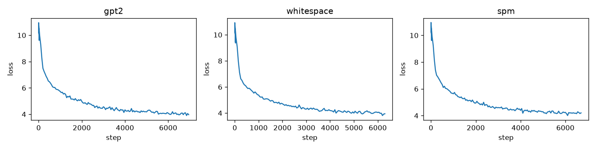
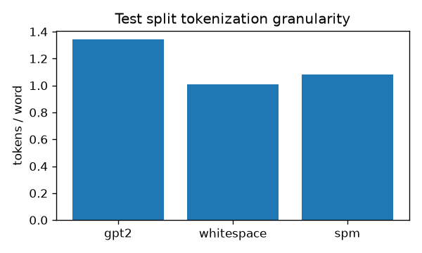

# Lab 01: Tokenization Efficiency Benchmark

**Course:** UMISI Computational Linguistics  
**Author:** Wojciech Mackowiak

Background on the pipeline, tokenizers, metrics, and model is in [OPIS_LABU.md](OPIS_LABU.md) (Polish).

## 1. Introduction

I compared three tokenization setups on the same language modeling task: Hugging Face **GPT-2 BPE**, a custom **whitespace and punctuation** tokenizer with a fixed vocabulary and `<UNK>`, and a **SentencePiece Unigram** model trained on WikiText-103 train. Each setup uses vocabulary size **N = 50,257**. I trained three separate **decoder-only GPT** models from random initialization with identical architecture and optimization settings; only the tokenization differed.

## 2. Data

**Corpus:** WikiText-103 raw (`Salesforce/wikitext`, `wikitext-103-raw-v1`).

**Preprocessing:** empty lines removed; WikiText placeholders `@-@`, `@,@`, and `@.@` mapped to `-`, `,`, and `.`.

**Splits:** standard train / validation / test. All reported perplexities and tokenization statistics use the **test** split (~1.28 MB, 241,211 words, 1,273,806 characters). The test set was not used to build the whitespace frequency dictionary or to train SentencePiece (training used `train.txt` only).

**Word** counts use whitespace splitting on cleaned text. **Character** counts include every UTF-8 character in the test file, including newlines.

## 3. Tokenizers and vocabulary sizes

| Tokenizer | Type | Vocabulary | Training corpus | Build time (s) |
|-----------|------|------------|-----------------|----------------|
| gpt2 | Pre-trained byte-level BPE | 50,257 | OpenAI `gpt2` (cached locally) | 1.3 |
| whitespace | Word + punctuation + `<UNK>` | 50,257 | Top 50,254 types from train + `<PAD>`, `<EOS>`, `<UNK>` | 34.5 |
| spm | SentencePiece Unigram | 50,257 | `train.txt`; 150k sentences sampled; `character_coverage=0.9999` | 105.0 |

## 4. Model architecture and hyperparameters

The language model is a **custom GPT-style decoder-only Transformer** implemented in PyTorch (`model.py`), following the usual nanoGPT-style layout (pre-LayerNorm blocks, causal attention, tied input/output embeddings). Weights are **not** loaded from OpenAI; all three runs start from random initialization.

**Architecture**

| Setting | Value |
|---------|-------|
| Layers | 6 |
| Attention heads | 8 |
| Model dimension | 512 |
| FFN inner dimension | 2048 |
| Context length | 256 |
| Dropout | 0.1 |
| Parameters (approx.) | 44.8M |

**Optimization (shared across runs)**

| Setting | Value |
|---------|-------|
| Optimizer | AdamW |
| Learning rate | 6×10⁻⁴ |
| Betas | (0.9, 0.95) |
| Weight decay | 0.1 |
| Warmup steps | 2,000 |
| Schedule | Cosine decay |
| Batch size | 64 × 256 tokens |
| Gradient clipping | 1.0 |
| Mixed precision | fp16 on GPU |
| Epochs over train text | 1 |

Because tokenized train streams differ in length, optimization steps and token counts per run were:

| Tokenizer | Training tokens | Steps |
|-----------|-----------------|-------|
| gpt2 | 114,503,705 | 6,988 |
| whitespace | 103,859,269 | 6,339 |
| spm | 110,081,114 | 6,718 |

## 5. Hardware

Training and evaluation ran on the **Ares** cluster (Cyfronet PLGrid), partition `plgrid-gpu-v100`:

- GPU: NVIDIA Tesla V100-SXM2 (32 GB)
- CPU: Intel Xeon Gold 6242 @ 2.80 GHz (4 cores allocated per job)
- Node memory: 32 GB
- PyTorch 2.14.1+cu126, Python 3.14.8

Peak GPU memory during training was about **13.9 GB** for all three runs.

## 6. Evaluation setup

**Perplexity:** sliding-window negative log-likelihood on the test token stream (context 256, stride 128). I report **word-level** perplexity exp(NLL / W) and **character-level** perplexity exp(NLL / C), plus bits per character. Token-level perplexity is omitted because the unit “token” is not comparable across tokenizers.

**UNK correction (whitespace only):** OOV words become a single `<UNK>` token, which the LM can predict too easily. I add a character unigram penalty (trained on train text) for OOV word content and report corrected word perplexity.

**Tokenization statistics:** computed on the full test split. “Direct word” means the word encodes to exactly one subword token (`is_direct`). For whitespace, OOV rate is the share of word occurrences mapped to `<UNK>`.

## 7. Results

### 7.1 Perplexity (test)

| Tokenizer | Word PPL | Char PPL | BPC | Word PPL (UNK-corrected) |
|-----------|----------|----------|-----|--------------------------|
| gpt2 | 77.41 | 2.28 | 1.188 | 77.41 |
| whitespace | 49.68 | 2.10 | 1.067 | 146.23 |
| spm | 77.91 | 2.28 | 1.190 | 77.91 |

Character-level perplexity ranks whitespace slightly better, but raw word perplexity for whitespace is misleading; after UNK correction it is the worst of the three.

### 7.2 OOV (whitespace tokenizer, test)

| Metric | Value |
|--------|-------|
| OOV word occurrences | 10,387 / 241,211 (**4.31%**) |
| OOV unique word types | 4,521 / 21,138 (**21.39%**) |

Subword tokenizers do not use a word-level `<UNK>` in this setup.

### 7.3 Tokenization statistics (test)

**Tokens per word**

| Tokenizer | Per isolated word | On full test text |
|-----------|-------------------|-------------------|
| gpt2 | 1.341 | 1.139 |
| whitespace | 1.010 | 1.022 |
| spm | 1.080 | 1.092 |

The isolated-word measure counts `encode(word)` without leading-space context, which inflates GPT-2 (missing `Ġ` prefix). Full-text averages are closer to what the LM sees.

**Coverage**

| Tokenizer | Direct words (occurrences) | Direct words (unique types) | Words in dictionary (occ.) |
|-----------|----------------------------|-----------------------------|----------------------------|
| gpt2 | 74.5% | 20.9% | 179,817 |
| whitespace | 95.7% | 78.6% | 230,824 |
| spm | 94.8% | 73.8% | 228,625 |

Here “direct” for subword tokenizers means one token spans the whole word, not that the word is a dictionary entry.

**Tokenizer encode throughput (test corpus)**

| Tokenizer | Tokens/s |
|-----------|----------|
| gpt2 | 350k |
| whitespace | 2.83M |
| spm | 2.60M |

GPT-2 via Hugging Face is much slower on this CPU-side encoding benchmark.

### 7.4 Training and inference efficiency

| Tokenizer | Train wall time (s) | Train tokens/s | Eval NLL (s) | Gen. 32 tok (tok/s) |
|-----------|---------------------|----------------|--------------|---------------------|
| gpt2 | 1201 | 95.3k | 10.4 | 179 |
| whitespace | 1056 | 98.4k | 9.5 | 125 |
| spm | 1154 | 95.4k | 10.0 | 176 |

The bar chart uses the isolated-word tokens-per-word statistic from `tok-stats`.

## 8. Qualitative examples

I used three texts (≥30 words): a long WikiText test line, modern out-of-domain prose, and rare names or scientific terms. Full token strings are in [results/qualitative.md](results/qualitative.md).

**Summary**

| Sample | Tokenizer | Tokens | Tok/word | Direct words |
|--------|-----------|--------|----------|--------------|
| WikiText (166 w) | gpt2 | 179 | 1.08 | 71.1% |
| | whitespace | 167 | 1.01 | 95.2% |
| | spm | 176 | 1.06 | 94.0% |
| Modern OOD (33 w) | gpt2 | 57 | 1.73 | 36.4% |
| | whitespace | 50 | 1.52 | 66.7% |
| | spm | 73 | 2.21 | 63.6% |
| Rare terms (33 w) | gpt2 | 58 | 1.76 | 39.4% |
| | whitespace | 42 | 1.27 | 78.8% |
| | spm | 52 | 1.58 | 78.8% |

**WikiText excerpt (actor Robert Boulter):** GPT-2 splits the surname (`ĠB | oul | ter`) and `Herons` (`ĠHer | ons`); whitespace maps `Boulter`, `Herons`, and several proper nouns to `<UNK>`; SPM keeps `▁Boult | er` and `▁Heron | s` without full-word UNK.

**Modern OOD:** `ChatGPT`, `COVID-19`, and the URL fragment produce many `<UNK>` or fine-grained pieces for whitespace; GPT-2 splits `ChatGPT` and `COVID-19` predictably; SPM splits the URL aggressively (`ex | amp | le`, `he | al | th`) and merges `latency` oddly (`▁late | ncy`), yielding the highest tok/word on this snippet.

**Rare terms:** `Psittacosaurus` stays one token in whitespace (in-vocabulary type); `Ulaanbaatar` is `<UNK>` for whitespace but subworded by GPT-2 and SPM; `Spectroscopy` is `<UNK>` for whitespace only.

## 9. Discussion

**Whitespace word perplexity.** Raw word PPL (49.7) looks best but drops to 146.2 after UNK correction. The model learns to emit `<UNK>` for unseen words instead of modeling their characters, which is an artifact of the tokenizer—not better generalization.

**GPT-2 vs SPM on WikiText.** Word and character perplexities are nearly identical (~77.4 word PPL, ~2.28 char PPL) even though SPM was trained on this domain and uses fewer tokens per word on the test stream (1.09 vs 1.14). GPT-2 BPE is strong out of the box for English Wikipedia-style text.

**Granularity vs OOD.** On in-domain WikiText, whitespace has the fewest tokens per word and the highest “direct word” rate, at the cost of 4.3% OOV occurrences. On modern or rare text, subword models avoid UNK but increase sequence length (especially SPM on the OOD paragraph).

**Efficiency.** Custom whitespace and SentencePiece encoding are an order of magnitude faster than GPT-2 tokenization in my CPU benchmark. Training wall time differs by ~2–14% between runs, driven mainly by sequence length and step count, not vocabulary size (fixed at 50,257).

**Fairness of training steps.** One epoch over raw text is not the same number of gradient updates across tokenizers. A stricter comparison could fix either total tokens or total steps; here I followed equal epochs as in the assignment brief.

**Metric caveat.** Reporting tokens per word on isolated words overstates GPT-2 fragmentation; I include full-text averages in Section 7.3 for a clearer picture.

## 10. Conclusions

Subword tokenization (GPT-2 BPE and domain-trained SentencePiece) gave similar LM quality on WikiText test when measured by word and character perplexity. The whitespace tokenizer looked better only before correcting for `<UNK>`. For production-style English LMs, fixed word dictionaries with UNK are hard to compare fairly on perplexity alone; subword methods trade slightly longer sequences for coverage. SentencePiece trained on WikiText helped in-domain compression but did not beat a frozen GPT-2 tokenizer on this benchmark; both clearly outperformed whitespace once OOV bias is accounted for.

## 11. References

- Kudo, T. SentencePiece. EMNLP 2018.
- Sennrich, Haddow, Birch. Neural Machine Translation of Rare Words with Subword Units. ACL 2016.
- Mielke, S. Comparing perplexities. https://sjmielke.com/comparing-perplexities.htm
